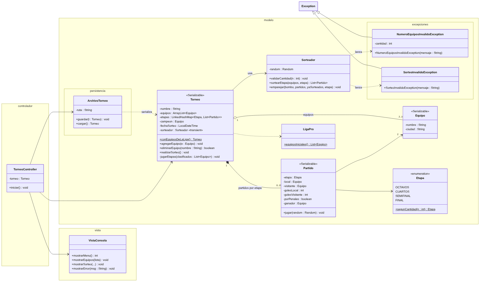

# Sorteo de equipos para una liga profesional

**Universidad Politécnica Salesiana – Ingeniería en Software**
Programación Orientada a Objetos – Unidad 3: Manejo de Excepciones y Archivos
Estudiante: Andy Javier Ortiz Valdiviezo · Docente: Gustavo Navas Ruilova

## Descripción

Aplicación de consola en Java que sortea los partidos de una copa de eliminación directa con los 16 equipos de la LigaPro de Ecuador. El sorteo arma los cruces de octavos de final, cuartos, semifinales y la final; en cada partido se simula el marcador (si hay empate se define por penales) y el ganador pasa a la siguiente etapa hasta tener un campeón.

El proyecto está organizado con el patrón **Modelo-Vista-Controlador**, usa **excepciones propias** para los errores del sorteo y guarda el estado del torneo en un archivo binario **torneo.ser** mediante **serialización de objetos**.

## Cómo se cumplen los requisitos

| Requisito | Dónde está |
|---|---|
| 16 equipos iniciales | `modelo.LigaPro.equiposIniciales()` |
| Sorteo aleatorio de octavos, cuartos, semifinal y final | `modelo.Torneo.realizarSorteo()` |
| Sorteo **recursivo** | `modelo.Sorteador.emparejar(...)`: saca dos equipos al azar del bombo, forma el partido y se llama de nuevo con los que quedan; el caso base es el bombo vacío. Además `Torneo.jugarEtapas(...)` avanza de etapa en etapa también de forma recursiva hasta que queda un campeón. |
| Ningún equipo repite partido en una etapa ni juega contra sí mismo | Conjunto `yaSorteados` dentro de la recursión + validación en el constructor de `Partido` |
| `NumeroEquiposInvalidoException` | Se lanza en `Sorteador.validarCantidad()` cuando la cantidad no es potencia de 2 (16, 8, 4, 2), es menor a 2 o mayor a 16 |
| `SorteoInvalidoException` | Se lanza dentro del método recursivo `emparejar()` si un equipo queda sin rival, se repite o saldría contra sí mismo |
| Captura con try-catch | `controlador.TorneoController` captura las excepciones propias, `FileNotFoundException`, `InvalidClassException`, `IOException` y `ClassNotFoundException` |
| Clase `Torneo` Serializable | `modelo.Torneo implements Serializable` (también `Equipo` y `Partido`) |
| Guardar con `ObjectOutputStream` + `FileOutputStream` | `modelo.persistencia.ArchivoTorneo.guardar()` |
| Cargar con `ObjectInputStream` + `FileInputStream` | `modelo.persistencia.ArchivoTorneo.cargar()`; se llama al iniciar el programa y desde el menú |

## Estructura del proyecto

```
src/main/java
├── app/                      Main (arma la vista, el controlador y el archivo)
├── controlador/              TorneoController
├── modelo/                   Equipo, Partido, Etapa, Torneo, Sorteador, LigaPro
│   ├── excepciones/          NumeroEquiposInvalidoException, SorteoInvalidoException
│   └── persistencia/         ArchivoTorneo (torneo.ser)
└── vista/                    VistaConsola
src/test/java
└── pruebas/                  PruebasTorneo (17 pruebas)
docs/                         diagrama de clases
```

## Diagrama de clases



## Cómo ejecutarlo

Requisitos: JDK 17 o superior y Eclipse IDE (o cualquier IDE de Java).

**En Eclipse**

1. Descargar el repositorio (*Code → Download ZIP*) y descomprimirlo, o clonarlo:
   ```
   git clone https://github.com/soyandyortiz/POO-U3-AndyOrtiz.git
   ```
2. *File → Import → General → Existing Projects into Workspace* y elegir la carpeta del proyecto.
3. Ejecutar `src/main/java/app/Main.java` con *Run As → Java Application*.
4. Para las pruebas, ejecutar `src/test/java/pruebas/PruebasTorneo.java` de la misma forma.

**Por consola**

```
javac -encoding UTF-8 -d bin src/main/java/app/*.java src/main/java/controlador/*.java src/main/java/modelo/*.java src/main/java/modelo/excepciones/*.java src/main/java/modelo/persistencia/*.java src/main/java/vista/*.java src/test/java/pruebas/*.java
java -cp bin app.Main
java -cp bin pruebas.PruebasTorneo
```

## Uso

Al iniciar, el programa intenta cargar `torneo.ser`; si todavía no existe, empieza con los 16 equipos de la liga.

```
============ SORTEO LIGA PROFESIONAL ============
 1. Ver equipos inscritos
 2. Inscribir un equipo
 3. Eliminar un equipo
 4. Realizar sorteo (octavos hasta la final)
 5. Ver resultados del último sorteo
 6. Guardar torneo (torneo.ser)
 7. Cargar torneo (torneo.ser)
 8. Restablecer los 16 equipos de la liga
 0. Salir
=================================================
```

Si se elimina un equipo (opción 3) y se intenta sortear con 15, el programa muestra el error de `NumeroEquiposInvalidoException` y no se cae. El archivo `torneo.ser` se crea en la carpeta del proyecto al usar la opción 6 o al salir guardando.
